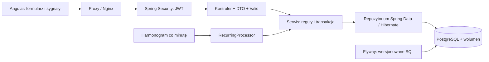

# Dukat

Aplikacja portfolio do ewidencji finansów osobistych: Angular 22, Java 21 / Spring Boot 4, PostgreSQL 15. Szafirowy interfejs, konta, historia, budżety, cele, płatności cykliczne, przelewy oraz statystyczna prognoza wydatków. Kwoty w PLN. Brak integracji bankowej.

## Uruchomienie na Windows

Wybierz jeden tryb. Do edycji i nauki w IntelliJ użyj sekcji „Tryb pracy nad kodem”. Poniższy `Start-Dukat.ps1` uruchamia **także backend i frontend w Dockerze** — wtedy aplikację otwierasz w przeglądarce, bez dodatkowego Run w IntelliJ.

Włącz Docker Desktop, otwórz terminal w katalogu projektu i wykonaj:

```powershell
.\scripts\Initialize-Dukat.ps1
.\scripts\Start-Dukat.ps1
```

Inicjalizacja tworzy lokalny, ignorowany przez Git plik `.env` i losowe sekrety. Istniejącego pliku nie nadpisuje. Jeśli korzystasz ze starego wolumenu, dane DB_USER/DB_PASSWORD muszą odpowiadać istniejącej bazie. Zmiana POSTGRES_PASSWORD w Compose sama nie zmienia hasła już utworzonego użytkownika PostgreSQL.

Skrypt startowy sprawdza zajęte porty i wykonuje `docker compose up -d --build --wait`. Po przygotowaniu `.env` można też uruchomić cały stack zwykłym `docker compose up --build`.

- Aplikacja: [localhost:4200](http://localhost:4200).
- Swagger: [localhost:8082/swagger-ui/index.html](http://localhost:8082/swagger-ui/index.html).
- Health: [localhost:8082/actuator/health](http://localhost:8082/actuator/health).
- pgAdmin: host `localhost`, port `5433`, baza `dukat_db`, użytkownik/hasło z lokalnego `.env`. pgAdmin jest osobnym klientem, nie częścią aplikacji.

Zarejestruj własny profil w UI albo użyj lokalnego profilu z DUKAT_BOOTSTRAP_USERNAME i DUKAT_BOOTSTRAP_PASSWORD. Po migracji istniejące dane należą do tego profilu. Hasło nie jest już generowane przy każdym starcie. Bootstrap ustawia hasło tylko podczas pierwszego utworzenia profilu; zmiana zmiennej później nie nadpisuje hasła w bazie.

Zatrzymanie bez usuwania danych:

```powershell
.\scripts\Stop-Dukat.ps1
```

## Port 8082 jest zajęty

Oznacza to, że drugi backend próbuje użyć tego samego portu. Gdy stack działa w Dockerze, nie uruchamiaj jednocześnie backendu w IntelliJ ani `npm start` na 4200. Skrypt wypisuje nazwę procesu i PID, lecz go nie zabija. Zatrzymaj poprzedni start jego przyciskiem Stop / Ctrl+C.

```powershell
docker compose ps
docker compose logs --tail=80 backend
Get-NetTCPConnection -State Listen -LocalPort 8082
```

## Tryb pracy nad kodem

To tryb dla IntelliJ i Angulara uruchamianego z terminala. Najpierw w terminalu głównego katalogu projektu wykonaj:

```powershell
.\scripts\Prepare-IntelliJ.ps1
```

Skrypt zatrzymuje kontenery backendu/frontendu tego projektu, pozostawia bazę z danymi, czeka na gotowość PostgreSQL i sprawdza porty. Nie uruchamia własnej kopii Javy ani Angulara. Kontenery aplikacji nie mają już automatycznego restartu po włączeniu Dockera; baza zachowuje tę funkcję.

Następnie:

1. W IntelliJ uruchom **DemoappApplication** przyciskiem **Run**. Poczekaj na `Started DemoappApplication`.
2. W terminalu głównego katalogu projektu uruchom Angulara:

```powershell
npm --prefix dukat-ui start
```

3. Otwórz [localhost:4200](http://localhost:4200). Terminal Angulara pozostaw uruchomiony.

Jeśli po świeżym pobraniu repo nie masz `dukat-ui/node_modules`, przed pierwszym startem wykonaj `npm --prefix dukat-ui ci`.

W IntelliJ ustaw JDK 21 i katalog roboczy na główny folder projektu, aby Spring odnalazł `.env`. Proxy Angulara przekazuje `/api` na 8082. Baza działa w Dockerze pod `localhost:5433`. Gdy kończysz pracę, zatrzymaj Javę przyciskiem Stop, a Angulara przez Ctrl+C. Do pełnego trybu Docker wrócisz przez `Start-Dukat.ps1` po zatrzymaniu obu lokalnych procesów.

## Jak działa aplikacja



JWT jest podpisany HS256, ważny godzinę i przechowywany wyłącznie w pamięci karty. Odświeżenie strony wymaga logowania. Hasła użytkowników mają hash BCrypt. Serwer pobiera właściciela z sesji JWT i filtruje zasoby po owner_id; klient nie wybiera właściciela w JSON.

- Konta: utworzenie, lista, edycja nazwy/rodzaju, zamknięcie przy saldzie 0 i przywrócenie. Historia pozostaje.
- Transakcje: dodatnia kwota z maks. 2 miejscami, data, opis, kategoria FK, INCOME/EXPENSE. Saldo i historia zapisują się razem pod blokadą konta. Wydatki mogą powodować ujemne saldo.
- Kategorie: tworzenie, zmiana nazwy, wyłączenie i przywrócenie. Nazwa w historii pochodzi z relacji; historyczny tekst pozostaje w bazie jako zapis starej wersji.
- Budżety: limit kategorii na miesiąc oraz rzeczywiste wydatki i pozostała kwota. Jeden limit na kategorię/miesiąc/profil.
- Cele: tworzenie, edycja, usuwanie i ręczny przyrost postępu. Nie przenoszą pieniędzy.
- Płatności cykliczne: zapis należnych terminów co minutę, ręczne wykonanie, pauza, edycja, ostatni błąd. Jeden termin może zostać zaksięgowany najwyżej raz. Maks. 12 terminów na jedno wywołanie; kolejne przejście uzupełnia dalsze zaległości. Dzień miesiąca jest zachowany, np. 31 stycznia → koniec lutego → 31 marca.
- Przelewy: pomiędzy dwoma własnymi aktywnymi kontami, przy wystarczającym saldzie; jeden rekord przelewu i dwie pozycje historii. TRANSFER_IN/OUT nie zwiększają przychodów/wydatków ani danych modelu.
- Dashboard: miesięczne sumy, sześć miesięcy wykresu, kategorie, historia i prognoza.

## Baza i migracja starej wersji

Flyway jest jedynym narzędziem zmieniającym schemat. Hibernate ma `ddl-auto=validate`. Migracje V1–V4 tworzą schemat lub obejmują istniejącą bazę historią, dodają właścicieli i FK kategorii, indeksy, przelewy, harmonogram oraz reguły nazw użytkownika. Inicjalizator przypisuje zachowane dane starej wersji do profilu lokalnego; stare cykle bez konta pozostają wstrzymane do uzupełnienia.

Wolumen `demoapp_dukat_postgres_data` przeżywa zatrzymanie/restart/reutworzenie kontenerów. Nie używaj `docker compose down -v`, jeśli chcesz zachować dane. Wolumen nie zastępuje kopii zapasowej. Przed migracją lokalnej bazy wykonano pg_dump i próbne odtworzenie na oddzielnej bazie.

## API, Postman i testy

Zaimportuj `postman/Dukat.postman_collection.json` oraz `postman/Local.postman_environment.json`. W lokalnym środowisku ustaw demoPassword (minimum 10 znaków) i uruchom Runner od początku. Kolekcja tworzy oddzielny profil z fikcyjnymi danymi: 25 żądań / 35 asercji. Możesz ustawić baseUrl na 4200, aby sprawdzić także proxy. Nie eksportuj uzupełnionego hasła ani wygenerowanego tokenu.

Swagger jest publiczny. Chronione operacje wymagają `Authorize` → tokenu z `POST /api/auth/login`. Nie dodawaj słowa Bearer do pola Swaggera; UI doda je samo. Modele wejścia/wyjścia mają opisy Schema; @Schema nie zastępuje walidacji.

```powershell
.\mvnw.cmd test
npm --prefix dukat-ui test -- --watch=false
npm --prefix dukat-ui run build
```

Testy backendu wymagają działającego Docker Desktop: Testcontainers uruchamia oddzielny, tymczasowy PostgreSQL na losowym porcie. Nie korzystają z Twojej bazy. Sprawdzają m.in. migracje, JWT, izolację, walidację, transfery, zachowanie historii, harmonogram i równoległe aktualizacje salda.

## Materiały do nauki i demonstracji

- `NOTATKA_DO_NAUKI_DUKAT.txt` — przepływ, języki, typy i wszystkie adnotacje/dekoratory.
- `INDEKS_PLIKOW_I_ADNOTACJI_DUKAT.txt` — pełny indeks źródeł i lokalizacje; odśwież przez `node scripts/generate-study-index.mjs`.
- `AUDYT_GOTOWOSCI_DUKAT.md` — stan wymagań i dowody sprawdzenia.
- `QUIZ_DUKAT.md` i `KLUCZ_QUIZU_DUKAT.md` — 35 pytań, 80 punktów.
- `MODEL_CARD_DUKAT.md` — modele, walidacja czasowa i ograniczenia.
- `PLAN_COMMITOW.md` — małe grupy zmian do samodzielnego zaznaczenia.

## Granica portfolio

To działające lokalne portfolio z praktykami przydatnymi w enterprise. Przed publicznym wdrożeniem pozostają: HTTPS i docelowa infrastruktura, odzyskiwanie hasła, limity prób logowania, polityka odwoływania/odświeżania tokenów, idempotencja ręcznych POST, monitoring i regularne backupy z próbami odtworzenia. Logout usuwa token z przeglądarki; nie unieważnia jego kopii na serwerze przed upływem ważności. Gospodarstwa/Membership/SettlementService pozostają szkicem poza modułami finansowymi UI. Prognoza wymaga historii i nie potwierdza kompletności ręcznych danych.

Źródła implementacyjne: [inicjalizacja bazy w Spring Boot](https://docs.spring.io/spring-boot/how-to/data-initialization.html), [PostgreSQL w Testcontainers](https://java.testcontainers.org/modules/databases/postgres/).
